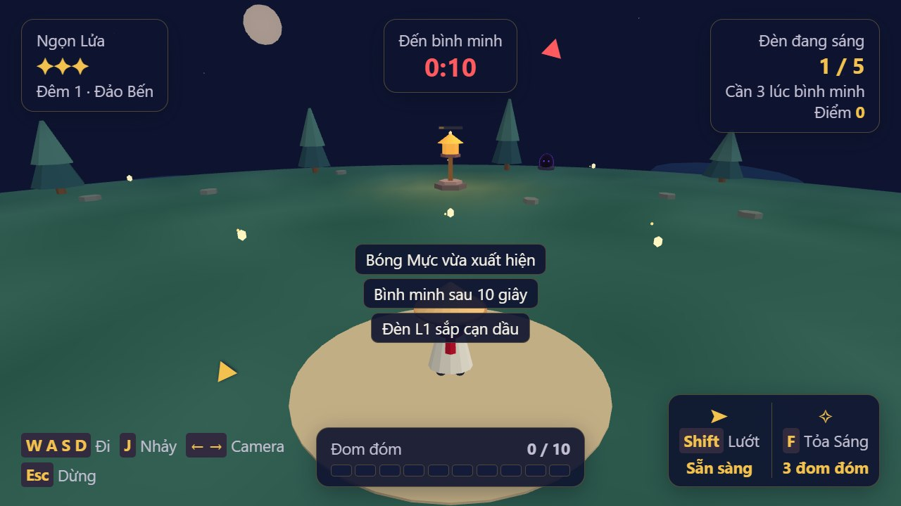

# Đảo Đèn Lồng

[Video demo và bản tải v1.0.0](https://github.com/NguyenTrang005/K5-L3A-DAY12-NguyenQuynhTrang-2A202603477-AI-SDLC-Dao-Den-Long/releases/tag/v1.0.0)

Theo chân Mây qua **Đảo Bến, Đảo Cau và Đảo Chuông**. Gom đom đóm, châm dầu và giữ đủ đèn sáng đến bình minh. Bản v1.0.0 dùng Test Contract **v1.3**.



## Chạy game

Cần Node.js 20 trở lên và trình duyệt desktop hỗ trợ WebGL. Benchmark cần Node.js 22 trở lên và Chrome hoặc Chromium. Chạy hai lệnh tại gốc repo. Trên Windows có thể dùng `npm.cmd` nếu PowerShell chặn `npm.ps1`.

```sh
npm run build
npm start
```

Mở **http://127.0.0.1:4173/**. Nếu cổng đã được dùng, đặt `PORT` trước khi chạy lệnh thứ hai. Ví dụ trên PowerShell dùng `$env:PORT='4174'; npm.cmd start` rồi mở cổng 4174.

| Phím | Hành động |
|---|---|
| W A S D | Di chuyển theo camera. Đến đủ gần để tự nhặt đom đóm hoặc Bùa Gió. |
| Space | Nhảy. Chạm bục nhảy trên mặt đất để được phóng. |
| Shift | Lướt. Đang có Bùa Gió thì có thể lướt lại sau khi hết lượt lướt hiện tại. |
| E | Nạp đom đóm vào đèn gần nhất còn nhận được. Đèn đang sáng nhận thêm dầu. |
| F | Tỏa Sáng với 3 đom đóm. Có thể lấy lại đồ từ Gió Lạc đang mang đom đóm đã cướp. |
| ← → hoặc kéo chuột trên cảnh | Xoay camera. |
| Esc hoặc P | Tạm dừng hoặc tiếp tục. Có thể chơi lại Đêm, chỉnh cài đặt hoặc về menu. |

Đèn cần **10 đom đóm** để thắp lần đầu, **5** để thắp lại. Đèn sáng mất 1 dầu mỗi giây. Mỗi đom đóm châm thêm tối đa 10 dầu. Khi dầu dưới 30, đèn nhấp nháy, mất vùng an toàn và có thể bị Bóng Mực hút dầu. Mây có 3 Ngọn Lửa mỗi Đêm. Sức chứa bắt đầu ở 10 và tăng thêm 2 mỗi lần thắp, tối đa 20.

| Đêm | Thời gian | Đèn cần giữ sáng lúc bình minh |
|---|---:|---:|
| Đảo Bến | 4 phút | 3/5 |
| Đảo Cau | 4 phút 30 giây | 4/6 |
| Đảo Chuông | 5 phút | 5/7 |

Mỗi đom đóm nạp được 5 điểm. Thắp lần đầu được 100, thắp lại được 40. Tỏa Sáng được 5 điểm mỗi Bóng Mực trúng, hoặc 15 nếu con đó đang hút dầu. Khi thắng, mỗi đèn còn sáng được 50 điểm cộng phần dầu nguyên, và mỗi Ngọn Lửa còn lại được 50. Màn Bình Minh hiển thị tổng điểm của ba Đêm đã thắng.

Bảng xếp hạng giữ 10 kết quả cao nhất trên máy. Lưu điểm sau khi thua hoặc khi hoàn thành cả ba Đêm. Tên gồm 3–12 ký tự A–Z, a–z, 0–9 hoặc `_`. Dùng `node scripts/serve.mjs --export-leaderboard out.json` để xuất tệp đang lưu trên đĩa. Bản triển khai tĩnh lưu điểm trong trình duyệt.

Trong **Cài đặt**, bạn có thể đổi và khôi phục phím, chỉnh âm lượng và chuột, bật chữ lớn, giảm chuyển động hoặc dùng bảng màu dễ phân biệt. HUD báo Bóng Mực mới xuất hiện, gió sắp thổi, 10 giây cuối và đèn yếu. Đèn tắt có thân giấy xẹp và rách.

## Chạy kiểm chứng và headless

```sh
npm run verify
```

Lệnh build, chạy test, soak và lưu TAP, replay và số đo vào `dist/proof/phase-4/`. Để chạy riêng headless, chọn `--night 1`, `2` hoặc `3`. Ví dụ dưới đây ghi cảnh Bóng Mực hút dầu, châm dầu và thắng lúc bình minh.

```sh
node src/headless.mjs --seed 42 --night 1 --ticks 240 --out fuel-drain.jsonl --scenario tests/fixtures/fuel-drain.scenario.json --inputs tests/fixtures/fuel-drain.inputs.json
```

## Benchmark và soak

```sh
node scripts/bench.mjs --seed 42 --duration 30 --out bench.json
node --expose-gc --max-semi-space-size=1 scripts/soak.mjs --seed 7 --nights 10 --out soak.json
```

Benchmark mở cửa sổ riêng với vùng vẽ 1280×720, khởi động 3 giây rồi đo đủ 30 giây. Đặt biến `LANTERN_BROWSER` thành đường dẫn Chrome/Chromium nếu trình khởi chạy không tự tìm thấy. WebGL không điều khiển được vsync của màn hình. Trình khởi chạy xin bỏ giới hạn khung hình ở Chromium, còn `vsync_off` ghi `false` vì không xác nhận được scanout. `peak_mem_mb` ghi `null` vì bộ nhớ RSS riêng của trang phân bổ qua các tiến trình trình duyệt. Soak chạy headless trong một tiến trình Node, giới hạn semi-space của V8 và đo RSS sau cùng một bước thu gom ở đầu và cuối phép thử.

Xem [Test Contract](game.contract.json), [kết quả benchmark](bench.json), [kết quả soak](soak.json), [bằng chứng Phase 4](docs/proof/phase-4/README.md), [changelog](CHANGELOG.md) và [retro](docs/retro.md). Dùng các tag `phase-1`, `phase-2` và `phase-3` để tái lập kết quả ở các phiên bản trước.

## Gói phát hành

Chạy `npm run package` để tạo `dist/dao-den-long-v1.0.0.tar.gz`. Gói có thư mục web tĩnh cùng máy chủ Node nhỏ, giấy phép và hướng dẫn chạy. Xem [cách quay demo và phát hành](docs/release.md).

## Sáng tạo của tôi

Biển mây dưới mép đảo và những hạt sáng nhỏ quanh đom đóm vẫn xuất hiện trong bản 3D. Nhạc và hiệu ứng được tổng hợp bằng Web Audio. Các hiệu ứng này thuộc phần trình bày của game.

Tài liệu lab gồm [hướng dẫn](GUIDE.md), [checkpoints](CHECKPOINTS.md), [cách nộp](SUBMISSION.md), [quy định](RULES.md) và [thang điểm](RUBRIC.md). Yêu cầu từng phase được phát hành trên [lab board](https://claude.ai/artifact/Q1RYyv1dxjUczzCbd2ZnoW).
